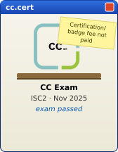
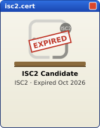

  

   
   

  <picture>
    <source media="(prefers-color-scheme: dark)" srcset="https://raw.githubusercontent.com/teodoramz/teodoramz/output/github-snake-dark.svg" />
    <source media="(prefers-color-scheme: light)" srcset="https://raw.githubusercontent.com/teodoramz/teodoramz/output/github-snake.svg" />
    
  </picture>
  
   
   

  

   
  
  <!-- certshelf:start -->

  
  
  
  

<!-- certshelf:end -->

